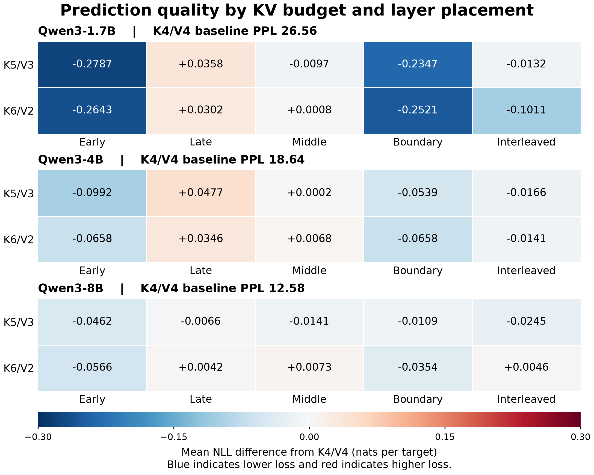

# Qwen3 offline KV budget comparison

All 33 configurations were scored on the same four historical 1,024-token WikiText windows (4,092 next-token targets per configuration). Mean NLL is weighted by the number of targets. PPL is its exponential. Lower values indicate better prediction on these windows.

Each budget uses eight payload bits per K/V coordinate pair on average. K4 uses Lloyd-Max, K8 uses the two-region piecewise-uniform quantizer, and V2 and V4 use Lloyd-Max. The cache sizes below include the packed indices and effective FP16 scales at CL1024. The measurements come from offline W4A16 replay. Device throughput and latency were unmeasured.

## Lowest observed NLL

These minima describe the four scored windows. Every mask was fixed before scoring, and none was tuned or selected for deployment on these results.

| Model | Plan | Mean NLL | PPL | CL1024 cache (MiB) |
|---|---|---:|---:|---:|
| Qwen3-1.7B | `k5_v3_early` | 3.000678 | 20.09916 | 28.875 |
| Qwen3-4B | `k5_v3_early` | 2.825978 | 16.87745 | 37.125 |
| Qwen3-8B | `k6_v2_early` | 2.475560 | 11.88836 | 37.125 |

## Matched budget differences

Differences are in nats per target. A negative difference means the first budget has lower mean NLL on the matched windows. K4/V4 uses one mask for every placement. K5/V3 and K6/V2 apply the named placement separately to their K8 and V4 quotas, so their higher-precision layers can overlap. Independent choices for K and V placement remain untested.

K5/V3 has lower mean NLL than both alternatives in 2/5 placements for Qwen3-1.7B, 2/5 placements for Qwen3-4B, 3/5 placements for Qwen3-8B.



| Model | Placement | K5/V3 - K6/V2 | K5/V3 - K4/V4 | K6/V2 - K4/V4 |
|---|---|---:|---:|---:|
| Qwen3-1.7B | early | -0.014480 | -0.278749 | -0.264269 |
| Qwen3-1.7B | late | +0.005559 | +0.035793 | +0.030235 |
| Qwen3-1.7B | middle | -0.010522 | -0.009708 | +0.000814 |
| Qwen3-1.7B | boundary | +0.017457 | -0.234667 | -0.252124 |
| Qwen3-1.7B | interleaved | +0.087921 | -0.013206 | -0.101127 |
| Qwen3-4B | early | -0.033384 | -0.099211 | -0.065828 |
| Qwen3-4B | late | +0.013178 | +0.047731 | +0.034554 |
| Qwen3-4B | middle | -0.006602 | +0.000219 | +0.006820 |
| Qwen3-4B | boundary | +0.011860 | -0.053915 | -0.065774 |
| Qwen3-4B | interleaved | -0.002556 | -0.016618 | -0.014061 |
| Qwen3-8B | early | +0.010402 | -0.046215 | -0.056616 |
| Qwen3-8B | late | -0.010754 | -0.006571 | +0.004182 |
| Qwen3-8B | middle | -0.021382 | -0.014119 | +0.007263 |
| Qwen3-8B | boundary | +0.024473 | -0.010941 | -0.035414 |
| Qwen3-8B | interleaved | -0.029116 | -0.024476 | +0.004640 |

## All configurations

| Model | Plan | Mean NLL | PPL |
|---|---|---:|---:|
| Qwen3-1.7B | `k4_v4` | 3.279427 | 26.56054 |
| Qwen3-1.7B | `k5_v3_early` | 3.000678 | 20.09916 |
| Qwen3-1.7B | `k5_v3_late` | 3.315220 | 27.52845 |
| Qwen3-1.7B | `k5_v3_middle` | 3.269719 | 26.30394 |
| Qwen3-1.7B | `k5_v3_boundary` | 3.044759 | 21.00498 |
| Qwen3-1.7B | `k5_v3_interleaved` | 3.266220 | 26.21208 |
| Qwen3-1.7B | `k6_v2_early` | 3.015158 | 20.39231 |
| Qwen3-1.7B | `k6_v2_late` | 3.309661 | 27.37586 |
| Qwen3-1.7B | `k6_v2_middle` | 3.280241 | 26.58217 |
| Qwen3-1.7B | `k6_v2_boundary` | 3.027303 | 20.64148 |
| Qwen3-1.7B | `k6_v2_interleaved` | 3.178300 | 24.00590 |
| Qwen3-4B | `k4_v4` | 2.925190 | 18.63776 |
| Qwen3-4B | `k5_v3_early` | 2.825978 | 16.87745 |
| Qwen3-4B | `k5_v3_late` | 2.972921 | 19.54894 |
| Qwen3-4B | `k5_v3_middle` | 2.925409 | 18.64184 |
| Qwen3-4B | `k5_v3_boundary` | 2.871275 | 17.65952 |
| Qwen3-4B | `k5_v3_interleaved` | 2.908572 | 18.33061 |
| Qwen3-4B | `k6_v2_early` | 2.859362 | 17.45039 |
| Qwen3-4B | `k6_v2_late` | 2.959743 | 19.29302 |
| Qwen3-4B | `k6_v2_middle` | 2.932010 | 18.76532 |
| Qwen3-4B | `k6_v2_boundary` | 2.859415 | 17.45132 |
| Qwen3-4B | `k6_v2_interleaved` | 2.911128 | 18.37753 |
| Qwen3-8B | `k4_v4` | 2.532176 | 12.58086 |
| Qwen3-8B | `k5_v3_early` | 2.485962 | 12.01267 |
| Qwen3-8B | `k5_v3_late` | 2.525605 | 12.49846 |
| Qwen3-8B | `k5_v3_middle` | 2.518057 | 12.40447 |
| Qwen3-8B | `k5_v3_boundary` | 2.521235 | 12.44395 |
| Qwen3-8B | `k5_v3_interleaved` | 2.507701 | 12.27667 |
| Qwen3-8B | `k6_v2_early` | 2.475560 | 11.88836 |
| Qwen3-8B | `k6_v2_late` | 2.536359 | 12.63359 |
| Qwen3-8B | `k6_v2_middle` | 2.539439 | 12.67256 |
| Qwen3-8B | `k6_v2_boundary` | 2.496762 | 12.14311 |
| Qwen3-8B | `k6_v2_interleaved` | 2.536817 | 12.63937 |

The score table includes full-precision metrics and the codec configuration hashes. [All scores](offline_scores.csv) · [Paired differences](paired_nll.csv)

## Reproduce the comparison

Run from the repository root with the archived split graphs, weights, calibration grids and token files available. The scoring command validates the frozen cohort, resumes completed windows, and writes the aggregate results under the experiment archive.

```bash
run_root=/mnt/d/ai-hub-models/binaries/turboquant/cross_model_pu_budget_20261120
report_dir=scripts/llm/turboquant/experiments/cross_model_pu_budget
export PYTHONPATH=src OPENBLAS_NUM_THREADS=1
venv/bin/python scripts/llm/turboquant/compare_cross_model_budgets.py --root "$run_root"
venv/bin/python scripts/llm/turboquant/report_cross_model_budgets.py --root "$run_root" --out "$report_dir"
```

Frozen selection protocol SHA-256 `a23fb7e569198f10b3ce03eee7bd6070395a9d114372b6c11bfeb89ed4f71620`. Offline score file SHA-256 `395090c39d533342bf564d34456e9216bd343b98f5a69f64c371ba8af335d0f5`.
